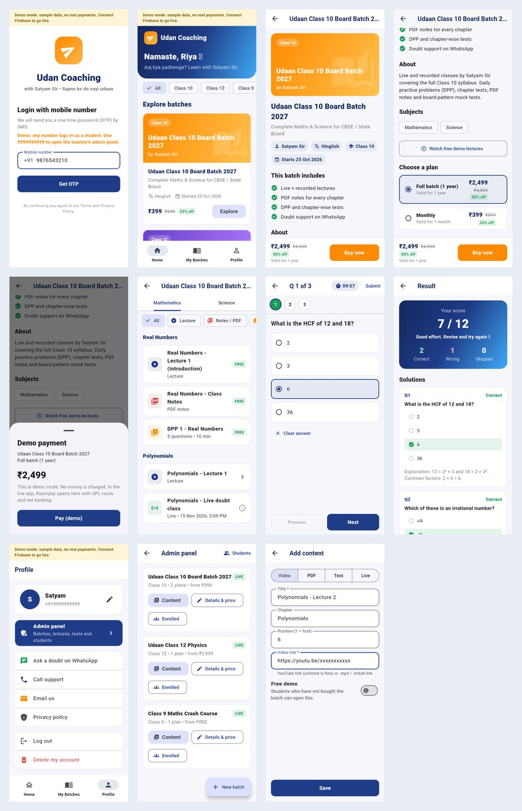

# Udan Coaching app

Android learning app for **Udan Coaching (Satyam Sir)**. Students buy batches and
study inside the app: lectures, PDF notes, tests and live classes. Satyam Sir
manages everything from the admin panel inside the same app.



```
udan-coaching/
├── app/                 Flutter Android app
├── firebase/
│   ├── firestore.rules  who can read/write what (tested)
│   ├── functions/       Razorpay payments + account deletion (server side)
│   ├── hosting/         privacy policy + delete-account pages (Play Store needs these)
│   └── rules-test/      automated tests for the security rules
├── docs/                screenshots
└── README.md            this guide
```

## What the app does

**Students**
- Login with mobile number + OTP
- Browse batches by class (Class 9, 10, 12, JEE, NEET…), see price, discount and validity
- Several plans per batch (e.g. Full batch 1 year / Monthly), or free batches
- Pay with UPI, cards, net banking or wallets (Razorpay)
- Watch free demo lectures before buying
- After buying: subjects → chapters → lectures, PDF notes, tests (DPP) and live classes
- Lectures from YouTube (unlisted is fine) or your own video links (.mp4 / .m3u8), with speed control
- Timed MCQ tests with negative marking, score and full solutions
- My Batches with validity and days left, renew when expired
- WhatsApp / call support, edit profile, log out, delete account
- Screenshots and screen recording are blocked

**Satyam Sir (admin)**: Profile → Admin panel
- Create and edit batches, price plans, publish or hide
- Add subjects, then lectures / PDFs / tests / live classes inside each subject
- Mark any item as a free demo
- Give a student access for fees paid in cash (search by mobile number)
- See who is enrolled in each batch and how much was collected online

**Security**: students can only open paid content while their access is valid.
Access is created only by the server after Razorpay confirms the payment (or by
an admin). Prices are read on the server, so nobody can change them from the phone.

## 1. Try it right now (demo mode)

Until Firebase is connected the app runs on sample data, with fake payments.

1. Open the repository on GitHub → **Actions** → **Udan Coaching app** → latest green run.
2. Download **udan-coaching-apk** under *Artifacts*, unzip, copy `app-release.apk` to an Android phone and install it
   (allow "install unknown apps").
3. Log in with any number, OTP **123456**. Log in with **9999999999** to see the admin panel.

## 2. Accounts you need

| What | Why | Cost |
|---|---|---|
| [Google Play Console](https://play.google.com/console/signup) | Publish the app | One-time USD 25 |
| [Firebase](https://console.firebase.google.com) (Blaze plan) | Login, database, payment functions | Pay as you go; small coaching usually stays in the free quota, but phone OTP SMS are billed per SMS |
| [Razorpay](https://dashboard.razorpay.com/signup) | Collect fees | ~2% per payment, no setup fee. KYC with PAN, bank account and business details |

Set a **budget alert** in Google Cloud billing so there are no surprises.

## 3. Connect Firebase

Install once on a computer: [Flutter](https://docs.flutter.dev/get-started/install), [Node.js 22](https://nodejs.org),
then `npm install -g firebase-tools` and `dart pub global activate flutterfire_cli`.

1. In the Firebase console create a project (e.g. `udan-coaching`). Upgrade it to the **Blaze** plan.
2. **Build → Authentication → Sign-in method → Phone → Enable.**
   Add a test number (e.g. `+91 9999999999`, code `123456`) for testing without SMS.
3. **Build → Firestore Database → Create database**, location **asia-south1 (Mumbai)**, production mode.
4. Connect the app (this replaces `app/lib/firebase_options.dart`; the app leaves demo mode):
   ```bash
   cd udan-coaching/app
   firebase login
   flutterfire configure --platforms=android --android-package-name=com.udancoaching.app
   ```
5. Add your SHA-1 and SHA-256 fingerprints in **Project settings → Your apps → Android** (phone login needs them):
   your upload key (`keytool -list -v -keystore upload-keystore.jks`) and, after the first Play upload,
   the **App signing key** shown in Play Console → *Test and release → App integrity*.
6. Put your project id in `firebase/.firebaserc`, then deploy the rules and pages:
   ```bash
   cd udan-coaching/firebase
   firebase deploy --only firestore,hosting
   ```
7. **Make Satyam Sir an admin**: log in to the app once with his number. In Firebase console →
   Authentication → Users, copy his *User UID*. In Firestore create collection `admins` with a document whose
   **id is that UID** (no fields needed). Reopen the app → Profile → Admin panel.

## 4. Connect Razorpay

1. Razorpay Dashboard → *Account & Settings → API keys* → generate keys (use **Test mode** first).
2. Give the keys to the server (never put the secret in the app):
   ```bash
   cd udan-coaching/firebase/functions
   npm ci
   echo "RAZORPAY_KEY_ID=rzp_test_xxxxxxxx" > .env
   firebase functions:secrets:set RAZORPAY_KEY_SECRET      # paste the key secret
   firebase functions:secrets:set RAZORPAY_WEBHOOK_SECRET  # make up a long random password
   cd .. && firebase deploy --only functions
   ```
3. Razorpay Dashboard → *Webhooks → Add*: URL
   `https://asia-south1-<your-project-id>.cloudfunctions.net/razorpayWebhook`,
   secret = the webhook secret from step 2, events **payment.captured** and **order.paid**.
   This unlocks the batch even if the student closes the app right after paying.
4. Test a purchase with Razorpay's [test UPI / cards](https://razorpay.com/docs/payments/payments/test-card-details/).
   When everything works, switch to **Live** keys (repeat step 2 with `rzp_live_…`) and redeploy.

## 5. Make it yours

- `app/lib/config/app_config.dart`: support phone, WhatsApp, email, privacy policy link (your Firebase Hosting
  address, e.g. `https://<project-id>.web.app/privacy`), batch categories.
- `firebase/hosting/privacy.html` and `delete-account.html`: fill every `[BRACKETED]` item.
- Icon: replace `app/assets/icon/*.png` and run `dart run flutter_launcher_icons`.
- Colours: `app/lib/config/theme.dart`.

## 6. Signing key (once, keep it forever)

The Play Store only accepts apps signed with your own key.

```bash
keytool -genkey -v -keystore upload-keystore.jks -keyalg RSA -keysize 2048 -validity 10000 -alias upload
```

Keep `upload-keystore.jks` and its passwords safe (Google Drive + a second copy). **Never commit it.**

To let GitHub build the Play Store file, add repository secrets in GitHub → *Settings → Secrets and variables → Actions*:

| Secret | Value |
|---|---|
| `UDAN_KEYSTORE_BASE64` | output of `base64 -w0 upload-keystore.jks` |
| `UDAN_KEYSTORE_PASSWORD` | keystore password |
| `UDAN_KEY_ALIAS` | `upload` |
| `UDAN_KEY_PASSWORD` | key password |

The next run then also produces **udan-coaching-play-store-aab** (the `.aab` file you upload).
To build on your own computer instead, create `app/android/key.properties` (see `app/android/app/build.gradle.kts`)
and run `flutter build appbundle`.

## 7. Publish on Google Play

1. Play Console → *Create app* → name "Udan Coaching", free app.
2. Upload the `.aab` to **Internal testing** first and install it from the Play link.
3. New *personal* developer accounts must run a **closed test with at least 12 testers for 14 days**
   before production access. Students and parents can be the testers.
4. Fill *App content*: privacy policy URL, **account deletion URL** (`…/delete-account`), Data safety
   (phone number, name, purchase history, app activity; collected, not sold, encrypted in transit; users can request
   deletion), content rating, target audience, ads = no.
   If you choose ages under 13 as target audience, Google's Families policy applies. Read it before submitting.
5. Store listing: icon `app/assets/icon/play_store_icon_512.png`, feature graphic 1024×500, at least 2 phone screenshots.
6. Every update: increase `version:` in `app/pubspec.yaml` (e.g. `1.0.1+2`; the number after `+` must always go up).

### Important: Google Play payment rules in India

Google Play's policy says apps selling digital content (like online batches) must offer **Google Play Billing**.
In India, developers may also offer another payment option such as Razorpay **alongside** it through Google's
*alternative / user choice billing* program, and Google still charges a service fee on those payments.
This app currently uses **Razorpay only**. Before going live, read Google's current
[Payments policy](https://support.google.com/googleplay/android-developer/answer/9858738) and the India billing
requirements, and decide together with a CA / advisor how to comply. Rules are being challenged in the
Supreme Court, so check what applies on the day you publish. Adding Google Play Billing next to Razorpay is a
possible follow-up.

## Day-to-day: adding content (for Satyam Sir)

1. **Profile → Admin panel → New batch**: name, class, description, what is included, plans with price,
   MRP and number of days. Switch on **Published** when ready. Switching it off later hides the batch from
   new buyers; students who already paid keep their access.
2. **Content → Add subject** (Maths, Science…). Open the subject → **Add content**:
   - **Video**: paste the YouTube link (upload the lecture to YouTube as *Unlisted*) or a video file link.
   - **PDF**: upload the PDF to Google Drive, *Share → Anyone with the link*, paste the link.
   - **Test**: add questions, 4 options, tick the right one, optional explanation. Set minutes and marks.
   - **Live**: YouTube Live / Zoom / Meet link + date and time.
   - Use the same **Chapter** name to group items. Switch on **Free demo** for sample lectures.
3. Cash fees: **Admin panel → Students** → search the mobile number → **Give access** → batch + days.

## Good to know

- **Video protection**: unlisted YouTube links can still be shared by a student who copies them. For
  stronger protection use a DRM video host (e.g. VdoCipher, Bunny Stream) and paste its HLS (.m3u8) link.
- **Tests** are checked on the phone, so a determined student could find answers inside the app's data. Fine for
  practice tests; important exams should stay on paper or a dedicated exam platform.
- Ideas for later: push notifications for new lectures and live classes, doubt chat, Hindi UI, iPhone version,
  Google Play Billing, coupons.

## For developers

```bash
cd app && flutter pub get && flutter analyze && flutter test       # app (12 tests)
flutter run --dart-define=DEMO=true                                 # force demo mode
cd ../firebase/functions && npm ci && npm test                      # payment logic (9 tests)
cd ../rules-test && npm ci && npm test                              # security rules in the emulator (10 tests, needs Java)
cd ../../app && flutter test test_screenshots/screenshots_test.dart --dart-define=OUT=$PWD/screenshots   # Play Store screenshots
```

The data layer is `app/lib/backend/backend.dart` (`FirebaseBackend` for real data, `DemoBackend` for sample data and tests).
